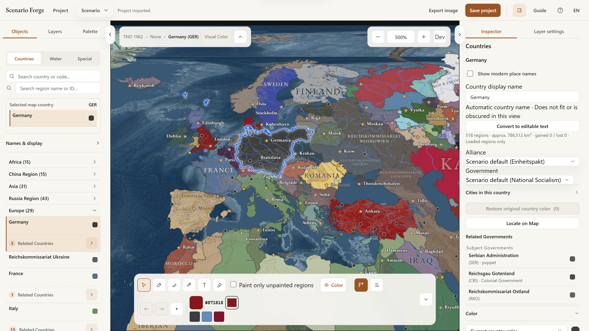
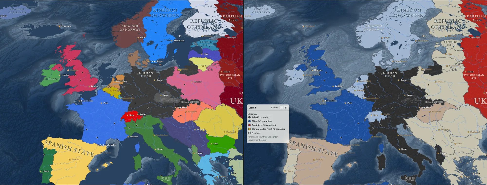
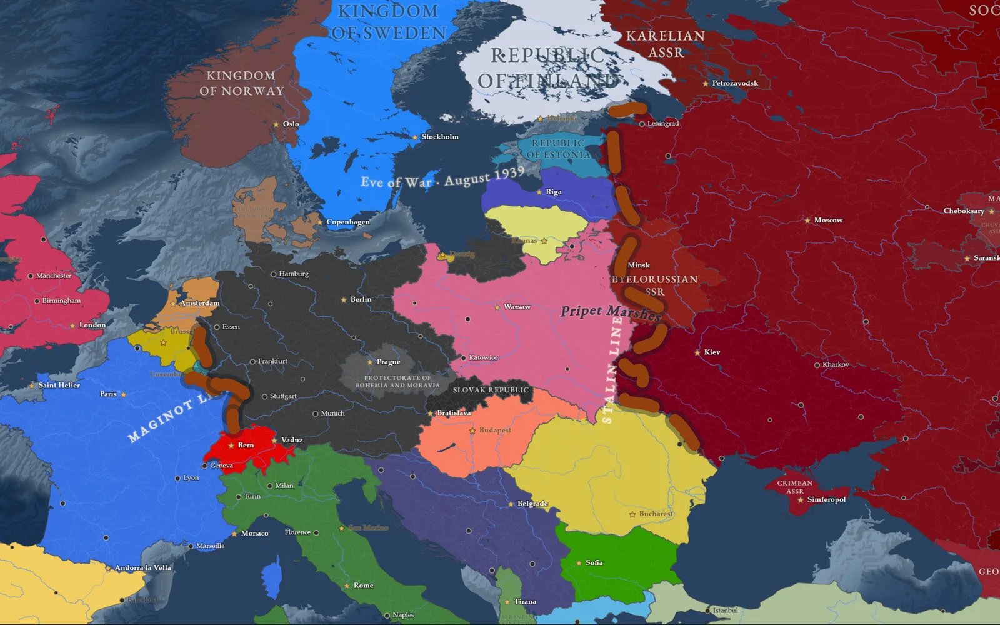
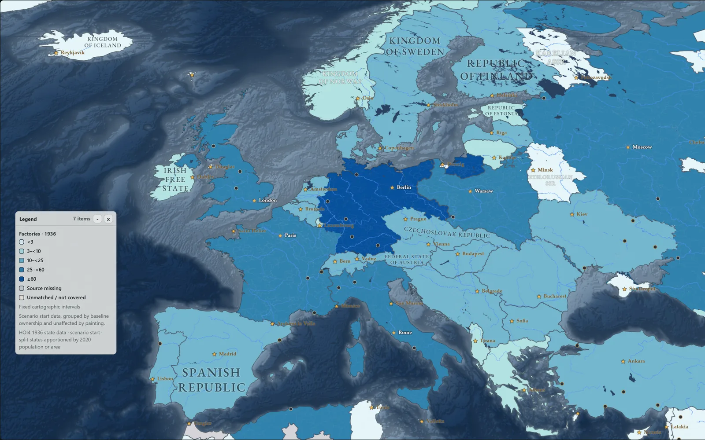
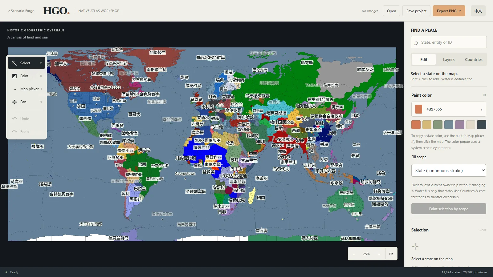

<div align="center">
  
  <h1>Scenario Forge</h1>
  <p><strong>Make a world your own.</strong></p>
  <p>A political map studio for alternate history and worldbuilding.</p>
  <p>
    <a href="https://raederhans.github.io/scenario-forge/app/?view=guide">Open Scenario Forge ↗</a>
    &nbsp; · &nbsp;
    <a href="https://raederhans.github.io/scenario-forge/hgo/">Open HGO Atlas ↗</a>
    &nbsp; · &nbsp;
    <a href="https://raederhans.github.io/scenario-forge/">Website</a>
    &nbsp; · &nbsp;
    <a href="README.zh-CN.md">简体中文</a>
  </p>
</div>

Two browser editors, one project. Nothing to install; projects are saved as files on your own computer.

| | Scenario Forge | HGO Atlas |
|---|---|---|
| **What it edits** | Vector political maps | The Historic Geographical Overhaul mod's native pixel map |
| **Scenarios** | Blank Map, Modern World, HOI4 1936, HOI4 1939, TNO 1962, and the regional Russian Civil War 1919 | HGO 1936 — 11,894 states (924 at sea), 20,782 provinces |
| **Open it** | [Editor ↗](https://raederhans.github.io/scenario-forge/app/?view=guide) | [HGO Atlas ↗](https://raederhans.github.io/scenario-forge/hgo/) |

## Scenario Forge



- **Pick a scenario** and paint the map province by province, or quick-fill whole regions. Register new countries, move capitals, and draw releasable countries from their preset borders.
- **Change the view, not the map.** Switch between countries, factions and government types; turn on modern place names next to the historical ones.
- **Letter the map.** Country names follow the territory you actually paint. Add your own straight or curved map text, frontlines and the scenario's preset defensive lines.
- **Read the scenario's own data.** Colour historical scenarios by starting population, resources or core territory (and factories in HOI4), and add roads, rail, terrain, rivers, night lights and ocean depth.
- **Keep and share your work.** Projects autosave in the browser and save as files. Export PNG or JPG at up to 4×, or share an editable project by link. English and Chinese interface.

<table>
  <tr>
    <td colspan="2"></td>
  </tr>
  <tr>
    <td colspan="2">One map, two questions: HOI4 1939 by country and by faction.</td>
  </tr>
  <tr>
    <td width="50%"></td>
    <td width="50%"></td>
  </tr>
  <tr>
    <td>Preset defensive lines and curved map text.</td>
    <td>Starting factories in HOI4 1936, from the scenario's own data.</td>
  </tr>
</table>

### Sample projects

Each sample opens as a ready project you can keep editing or download.

| Sample | What it shows |
|---|---|
| [Blank Map](https://raederhans.github.io/scenario-forge/app/?sample=blank-base-starter&view=guide) | Every subdivision drawn, none yet claimed |
| [Modern World](https://raederhans.github.io/scenario-forge/app/?sample=modern-world-japan-corridor&view=guide) | Today's borders, with a transport corridor in Japan |
| [HOI4 1936](https://raederhans.github.io/scenario-forge/app/?sample=hoi4-1936-europe-briefing&view=guide) | Europe on the first day of the game |
| [HOI4 1939](https://raederhans.github.io/scenario-forge/app/?sample=hoi4-1939-europe-switch&view=guide) | 14 August 1939, on the eve of war |
| [TNO 1962](https://raederhans.github.io/scenario-forge/app/?sample=tno-1962-atlantropa-briefing&view=guide) | The New Order, with a Mediterranean half drained by Atlantropa |
| [Russian Civil War 1919](https://raederhans.github.io/scenario-forge/app/?sample=rcw-1919-civil-war-briefing&view=guide) | October 1919, a regional map of the former Russian Empire and its neighbours |

## HGO Atlas



A separate editor for the Historic Geographical Overhaul mod's 1936 world on its native 5120 × 2560 map. Paint land and sea states, transfer ownership and cores between countries, rename regions, and export the full map as PNG. It needs a browser with WebGL 2, and its project files are separate from Scenario Forge's. Developer notes: [apps/hgo](apps/hgo/README.md).

## Run locally

On Windows with Python 3:

```powershell
.\start_dev.bat
```

The launcher prints the local editor URL. See [local development](docs/local-development.md) for setup. Before opening a PR, run `npm test` and follow [development and delivery](docs/development-and-delivery.md).

## License

Code and documentation are [MIT](LICENSE). Map data keeps its source terms, and mod assets keep their own — see the [source ledger](data/source_ledger.json).

[Report an issue](https://github.com/raederhans/scenario-forge/issues)
