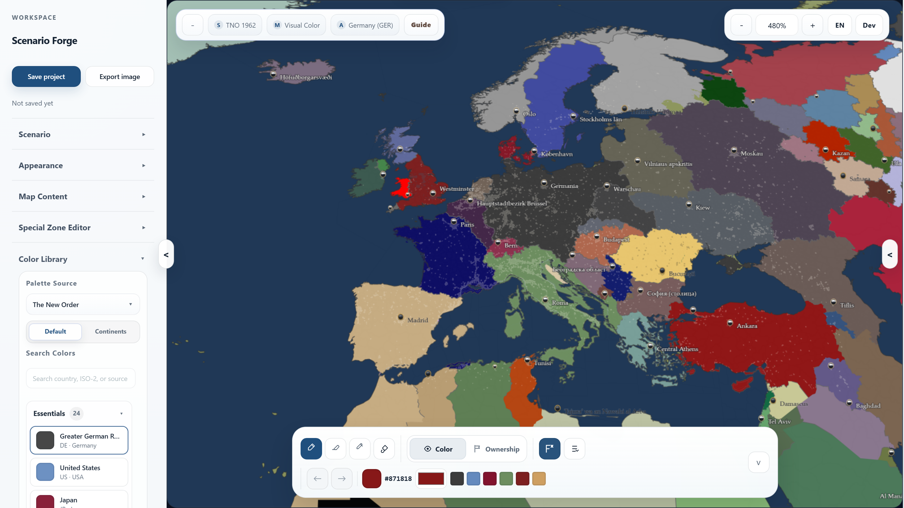
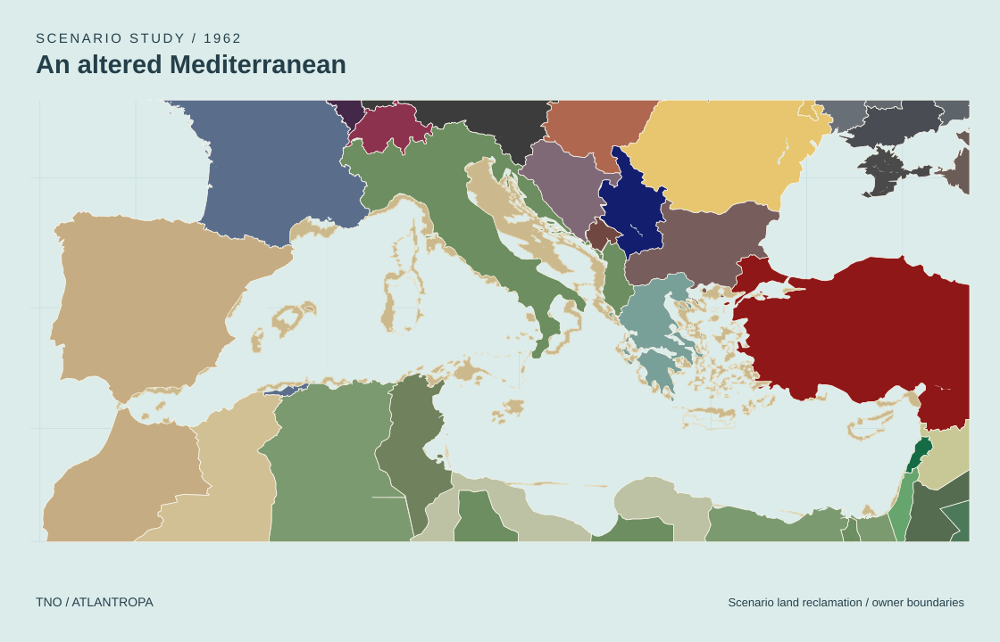
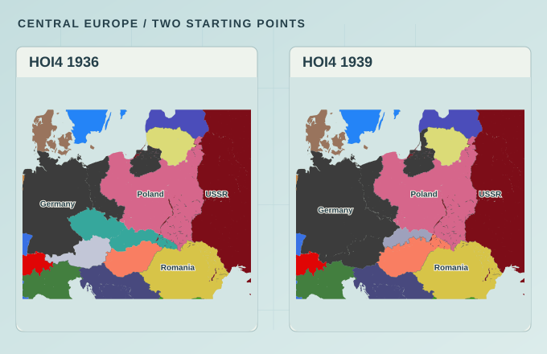
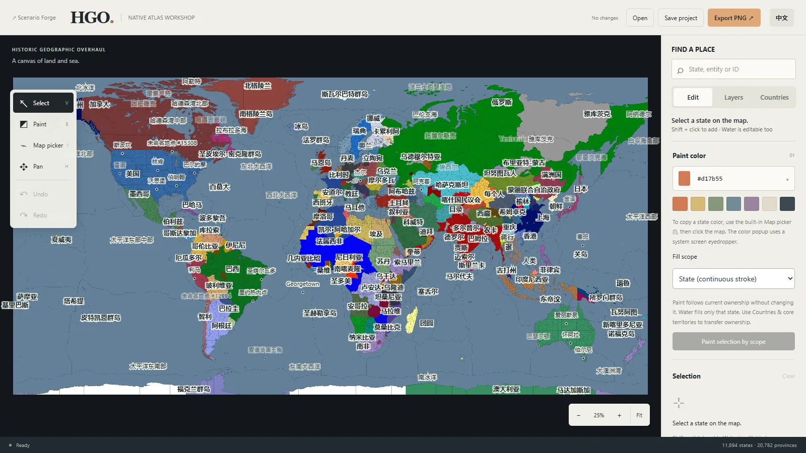

<div align="center">
  
  <h1>Scenario Forge</h1>
  <p><strong>把世界画成你的版本。</strong></p>
  <p>为架空历史与世界观创作打造的政治地图工作室。</p>
  <p>
    <a href="https://raederhans.github.io/scenario-forge/app/?view=guide">打开 Scenario Forge ↗</a>
    &nbsp; · &nbsp;
    <a href="https://raederhans.github.io/scenario-forge/hgo/">打开 HGO 地图集 ↗</a>
    &nbsp; · &nbsp;
    <a href="https://raederhans.github.io/scenario-forge/">官网</a>
    &nbsp; · &nbsp;
    <a href="README.md">English</a>
  </p>
</div>

一个项目，两个浏览器编辑器：

| | Scenario Forge | HGO 地图集 |
|---|---|---|
| **编辑对象** | 矢量政治地图 | Historic Geographic Overhaul 模组的原生像素地图 |
| **起点世界** | 空白地图、现代世界、HOI4 1936、HOI4 1939、TNO 1962 | HGO 1936：11,894 个州（含 924 个海域）、20,782 个省份 |
| **打开** | [编辑器 ↗](https://raederhans.github.io/scenario-forge/app/?view=guide) | [HGO 地图集 ↗](https://raederhans.github.io/scenario-forge/hgo/) |

## Scenario Forge



- **选择世界**，编辑归属、控制区、前线与特殊区域。
- **编排地图**：配色、边界、标签与图例，加入城市、公路、铁路、地形、河流与夜光。
- **导出**最高 4× 的 PNG 或 JPG，保存工程以便继续编辑。支持中英文界面。

<table>
  <tr>
    <td width="50%"></td>
    <td width="50%"></td>
  </tr>
  <tr>
    <td>TNO 1962 · Atlantropa —— <a href="https://raederhans.github.io/scenario-forge/app/?sample=tno-1962-atlantropa-briefing&view=guide">打开示例</a></td>
    <td>HOI4 1936 → 1939 —— <a href="https://raederhans.github.io/scenario-forge/app/?sample=hoi4-1936-europe-briefing&view=guide">1936</a> · <a href="https://raederhans.github.io/scenario-forge/app/?sample=hoi4-1939-europe-switch&view=guide">1939</a></td>
  </tr>
</table>

## HGO 地图集



独立的编辑器，以原生 5120 × 2560 地图打开 HGO 模组的 1936 年世界。为陆地与海域州上色，在国家之间转移归属与核心，重命名地区，并导出整张 PNG。开发说明见 [apps/hgo](apps/hgo/README.zh-CN.md)。

## 本地运行

在 Windows 上安装 Python 3 后运行：

```powershell
.\start_dev.bat
```

启动脚本会显示本地编辑器地址。环境准备与可选后端（Cloud Saves 与社区功能）见[本地开发文档](docs/local-development.md)。创建 PR 前运行 `npm test`，并参考[开发与交付](docs/development-and-delivery.zh-CN.md)。

## 许可

代码与文档采用 [MIT 许可证](LICENSE)。地图数据沿用各自来源的条款，见[数据来源账本](data/source_ledger.json)。

[反馈问题](https://github.com/raederhans/scenario-forge/issues)
