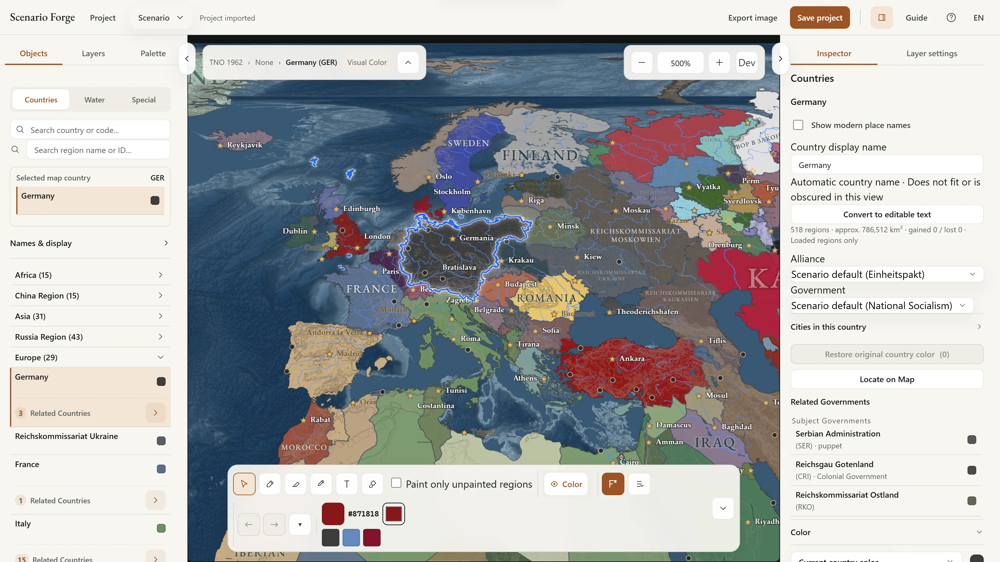
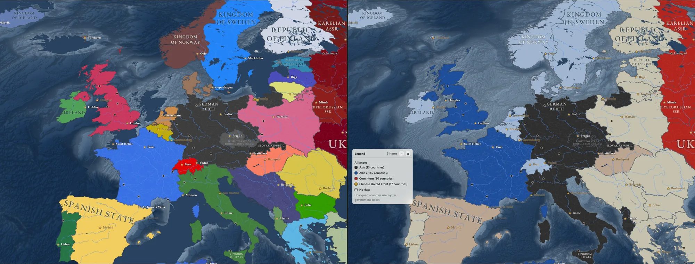
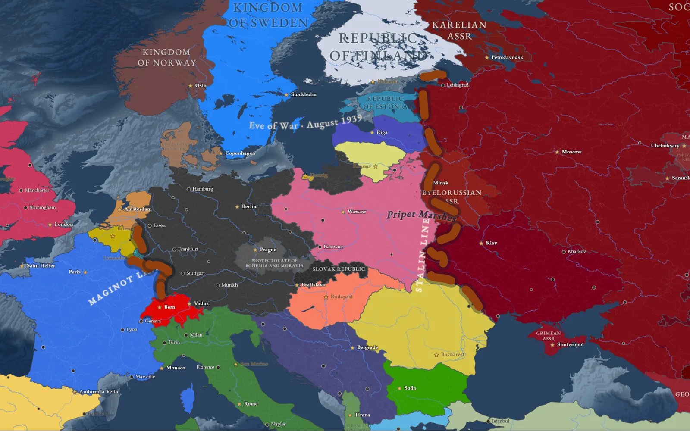
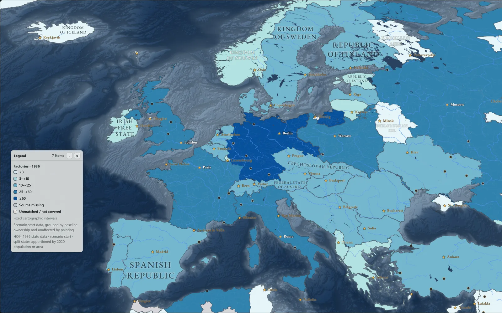
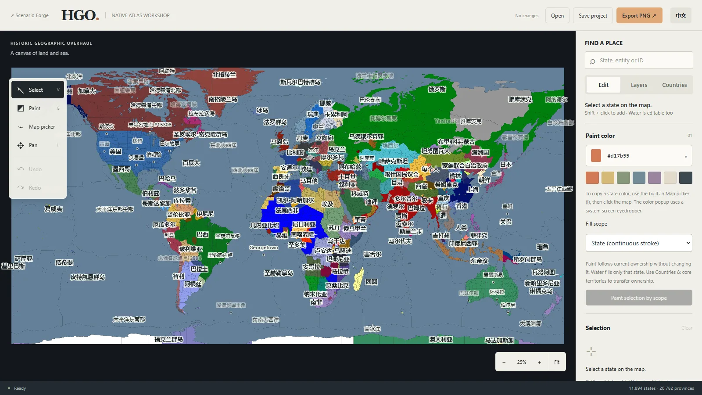

<div align="center">
  
  <h1>Scenario Forge</h1>
  <p><strong>把世界画成你的版本。</strong></p>
  <p>为架空历史与世界观创作打造的政治地图工作室。</p>
  <p>
    <a href="https://raederhans.github.io/scenario-forge/app/?view=guide">打开 Scenario Forge ↗</a>
    &nbsp; · &nbsp;
    <a href="https://raederhans.github.io/scenario-forge/hgo/">打开 HGO 地图集 ↗</a>
    &nbsp; · &nbsp;
    <a href="https://raederhans.github.io/scenario-forge/">官网</a>
    &nbsp; · &nbsp;
    <a href="README.md">English</a>
  </p>
</div>

一个项目，两个浏览器编辑器。无需安装，项目以文件形式保存在你自己的电脑上。

| | Scenario Forge | HGO 地图集 |
|---|---|---|
| **编辑对象** | 矢量政治地图 | Historic Geographical Overhaul 模组的原生像素地图 |
| **剧本** | 空白地图、现代世界、HOI4 1936、HOI4 1939、TNO 1962，以及区域剧本俄国内战 1919 | HGO 1936：11,894 个州（含 924 个海域）、20,782 个省份 |
| **打开** | [编辑器 ↗](https://raederhans.github.io/scenario-forge/app/?view=guide) | [HGO 地图集 ↗](https://raederhans.github.io/scenario-forge/hgo/) |

## Scenario Forge



- **选一个剧本**，逐块给地块上色，或按大区快速填充。可以登记新国家、更改首都，按预设疆界画出可释放国家。
- **换个角度看同一张图**：在国家、阵营、政体三种地图模式间切换；在时代地名旁对照今名。
- **给地图写字**：国名随实际涂出的版图自动摆放；可以加直排或弯曲的地图文字、前线，以及剧本预置的防线。
- **读剧本自己的数据**：历史剧本可按开局人口、资源、核心领土占比着色（HOI4 还有工厂数）；另有公路、铁路、地形、河流、夜光与海洋深度图层。
- **保存与分享**：浏览器自动保存草稿，项目可存成文件；导出最高 4× 的 PNG 或 JPG，也可以用链接分享可继续编辑的项目。界面支持中英文。

<table>
  <tr>
    <td colspan="2"></td>
  </tr>
  <tr>
    <td colspan="2">同一张图，两种问法：HOI4 1939 按国家与按阵营。</td>
  </tr>
  <tr>
    <td width="50%"></td>
    <td width="50%"></td>
  </tr>
  <tr>
    <td>剧本预置防线与弯曲的地图文字。</td>
    <td>HOI4 1936 开局工厂数，取自剧本自己的数据。</td>
  </tr>
</table>

### 示例项目

每份示例都以完整项目打开，可以接着编辑，也可以下载。

| 示例 | 内容 |
|---|---|
| [空白地图](https://raederhans.github.io/scenario-forge/app/?sample=blank-base-starter&view=guide) | 所有行政区都已画好，尚无归属 |
| [现代世界](https://raederhans.github.io/scenario-forge/app/?sample=modern-world-japan-corridor&view=guide) | 今天的疆界，附日本交通走廊示例 |
| [HOI4 1936](https://raederhans.github.io/scenario-forge/app/?sample=hoi4-1936-europe-briefing&view=guide) | 游戏开局第一天的欧洲 |
| [HOI4 1939](https://raederhans.github.io/scenario-forge/app/?sample=hoi4-1939-europe-switch&view=guide) | 1939 年 8 月 14 日，大战前夕 |
| [TNO 1962](https://raederhans.github.io/scenario-forge/app/?sample=tno-1962-atlantropa-briefing&view=guide) | 新秩序世界，地中海被亚特兰托帕工程抽干一半 |
| [俄国内战 1919](https://raederhans.github.io/scenario-forge/app/?sample=rcw-1919-civil-war-briefing&view=guide) | 1919 年 10 月，前俄罗斯帝国及邻国的区域地图 |

## HGO 地图集



Historic Geographical Overhaul 模组 1936 年世界的独立编辑器，直接在 5120 × 2560 的原生地图上工作：绘制陆地与海域州，在国家之间转移归属与核心，重命名区域，并把整张地图导出为 PNG。需要支持 WebGL 2 的浏览器，项目文件与 Scenario Forge 不通用。开发说明见 [apps/hgo](apps/hgo/README.zh-CN.md)。

## 本地运行

Windows 上安装 Python 3 后运行：

```powershell
.\start_dev.bat
```

启动器会打印本地编辑器地址。环境准备见[本地开发](docs/local-development.md)。提交 PR 前请运行 `npm test`，并按[开发与交付](docs/development-and-delivery.zh-CN.md)操作。

## 许可

代码与文档采用 [MIT](LICENSE) 许可。地图数据沿用各自来源的条款，模组素材按其自身条款使用，详见[来源账本](data/source_ledger.json)。

[报告问题](https://github.com/raederhans/scenario-forge/issues)
